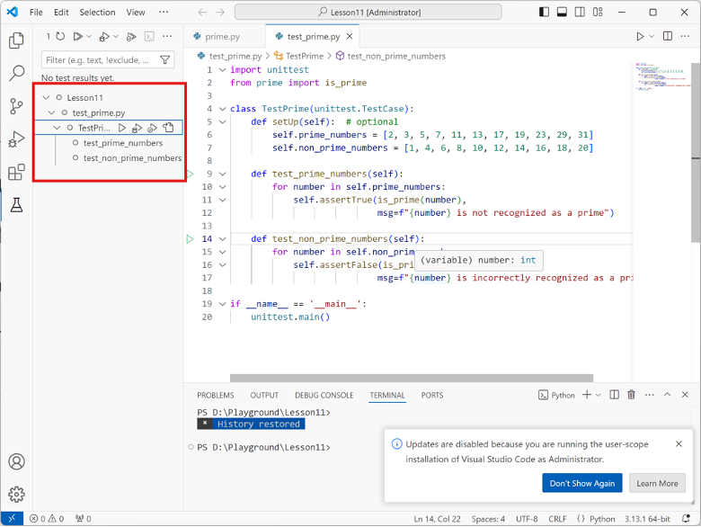

# Bug Report

This report documents the bugs discovered in the buggy programs, including the failing test cases, root cause analysis, and the applied code fixes.

---

## Bug Report 1: Consecutive Booking Conflict in MeetingRoom

### 1. Program Under Test
- **File:** `problem4.py`
- **Class / Function:** MeetingRoom.book()

### 2. Failing Test Case
Provide the unit test code from `test_problem4.py` that exposed the bug and failed during execution:

```python
# Paste your failing test method here
def test_back_to_back_meetings_allowed(self):
    """Test that valid consecutive / back-to-back meetings (e.g. 9-10 and 10-11) are permitted."""
    self.room.book("B01", "Morning Meeting", 9, 10, 3)
    self.room.book("B02", "Late Morning Meeting", 10, 11, 4)
    self.assertEqual(len(self.room.bookings), 2
```

Provide the captured test runs from VSCode.



**Test Output / Error Message:**
```text
ValueError: Time slot [10, 11] conflicts with booking 'B01' [9, 10]
```

### 3. Root Cause Analysis
Explain why the bug occurred and what incorrect behavior it caused:
- **Expected Behavior:** Back-to-back meetings (where the start time of the new booking equals the end time of an existing booking, e.g., 9–10 and 10–11) should be permitted without raising conflict errors.
- **Actual Behavior:** The system raised a ValueError, rejecting valid consecutive bookings.
- **Root Cause:** The condition checking for time overlaps used strict strict comparison (< and >) inside a negated logic statement if not (end_time < b["start_time"] or start_time > b["end_time"]), which incorrectly flagged boundary-touching time slots as overlapping conflicts.

### 4. Code Fix & Diff
Show the changes made to `problemX.py` to fix the bug:

```diff
- # Original buggy code line
+ # Corrected code line
```
- if not (end_time < b["start_time"] or start_time > b["end_time"]):
+ if not (end_time <= b["start_time"] or start_time >= b["end_time"]):
---

## Bug Report 2: Incorrect Aggregations and Missing Validation in Data Aggregator

### 1. Program Under Test
- **File:** `problem5.py`
- **Class / Function:** clean_and_aggregate()

### 2. Failing Test Case
Provide the unit test code from `test_problem4.py` that exposed the bug and failed during execution:

```python
# Paste your failing test method here
def test_aggregate_min_and_max(self):
    min_result = clean_and_aggregate(self.sample_sales, group_by="region", metric="sales", aggregation="min")
    self.assertAlmostEqual(min_result["North"], 100.0)

def test_empty_dataset_raises_value_error(self):
    with self.assertRaises(ValueError):
        clean_and_aggregate([], group_by="region", metric="sales")
```

Provide the captured test runs from VSCode.


**Test Output / Error Message:**
```text
FAIL: test_aggregate_min_and_max
AssertionError: 200.0 != 100.0 within 7 places

FAIL: test_empty_dataset_raises_value_error
AssertionError: ValueError not raised
```

### 3. Root Cause Analysis
Explain why the bug occurred and what incorrect behavior it caused:
- **Expected Behavior:** 
aggregation="min" should return the minimum value.   
aggregation="max" should return the maximum value.   
aggregation="count" should return a float value.   
Passing an empty list records ([]) should raise a ValueError.   
- **Actual Behavior:** 
min returned the maximum value, and max returned the minimum value.   
Passing an empty dataset returned {} instead of raising ValueError.
- **Root Cause:** 
The function logic inverted the min and max built-in calls (min executed max(values) and vice-versa).   
The input validation for checking empty records list was completely missing at the beginning of the function.   

### 4. Code Fix & Diff
Show the changes made to `problemX.py` to fix the bug:

```diff
- # Original buggy code line
+ # Corrected code line
```
def clean_and_aggregate(records, group_by, metric, aggregation="mean", filter_fn=None):
+     if not isinstance(records, list):
+         raise TypeError("records must be a list")
+     if not records:
+         raise ValueError("records list cannot be empty")
+
      # ...
      elif agg_op == "min":
-         val = max(values)
+         val = min(values)
      elif agg_op == "max":
-         val = min(values)
+         val = max(values)
      elif agg_op == "count":
-         val = len(values)
+         val = float(len(values))
---
 